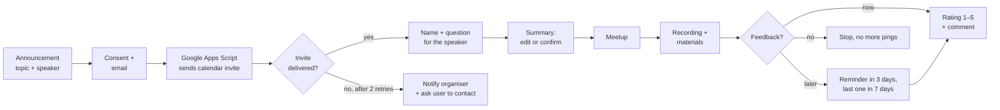

# PM Coffee Time Bot

A Telegram bot for **PM Coffee Time**, an online meetup series for project and product managers that I organise and host (70 episodes so far). The bot runs the full attendee journey: announcement → registration → calendar invite → reminders → recording and materials → feedback, so the organiser doesn't do any of it by hand.

The conversation is built **without code** in the SendPulse visual builder. Behind it, a small **Google Apps Script** backend ([apps-script/Code.gs](apps-script/Code.gs)) sends Google Calendar invites and keeps registrations and feedback in Google Sheets. The full flow logic is in [flows.md](flows.md).

## The problem

Every meetup used to mean the same manual routine: collect registrations from different chats, send calendar invites one by one, chase people who gave a broken email, send the recording afterwards, and ask for feedback that almost nobody gave. I wanted one entry point with predictable steps and data I could measure.

## How the journey works



## Design decisions

- **Email first, extras optional.** Only the email is required, because it is what the invite needs. Name and the question for the speaker come *after* the invite is sent, and both can be skipped, so a drop-off never costs a registration.
- **Delivery is checked, not assumed.** After the webhook asks Google Apps Script to send the invite, the bot reads the result back from Google Sheets. It retries after 15 seconds and after 2 minutes. If the invite still isn't sent, the user gets a clear message and the organiser gets a Telegram alert with the user's ID.
- **No silent dead ends.** A user who never leaves an email gets a gentle nudge, and the organiser is told after 2 hours. Any unrecognised message leads back to `/start`.
- **Feedback without nagging.** Three honest choices: *give feedback*, *watch first*, *no thanks*. "Watch first" gets at most two reminders (after 3 days and after 7 days). Tags (`fb-later`, `fb-done`, `fb-stop`) guarantee that nobody is reminded after answering or declining.
- **Rating scale in plain words.** Each score from 1 to 5 is described by behaviour ("turned it off almost immediately" … "will share the recording with friends"), not abstract numbers. This makes answers comparable.
- **Privacy built in.** Explicit consent before the email is asked for, `/privacy` with a policy, `/stop` to unsubscribe, and data deleted when the bot is blocked.

## Results

Numbers from the SendPulse statistics for meetups #69–#70:

| Metric | Value |
|---|---|
| Users who opened the registration flow | 129 |
| Pressed a registration button | 116 (90%) |
| Recording and materials delivered | 30 |
| Pressed a button under the materials | 15 (50%) |
| Feedback flow entered | 6 |

The weakest step is clearly feedback: half of the attendees click on the materials, but few leave a rating. A possible next step is a one-tap rating right inside the materials message.

## Stack

| Part | Tool |
|---|---|
| Conversation flows, tags, variables, delays, conditions | SendPulse chatbot builder (Telegram) |
| Calendar invites, saving answers | Google Apps Script, called by webhooks |
| Registrations and feedback storage | Google Sheets |
| Organiser alerts | SendPulse → Telegram notifications; Apps Script → email |

## Apps Script backend

[`apps-script/Code.gs`](apps-script/Code.gs) is about 200 lines. It is deployed as a web app, and SendPulse calls it by webhook:

```
POST <web app URL>?secret=<SECRET>&action=<action>&event=<meetup code, e.g. pmct-70>
```

| Action | What it does |
|---|---|
| `register` | Saves or updates the registration and adds the email as a guest to the matching Google Calendar event (Google sends the invite). If the email changes, it removes the old one |
| `details` | Saves the name and the question for the speaker |
| `cancel` | Marks the registration as cancelled and removes the guest |
| `feedback` / `fblater` / `fbstop` | Saves the rating and comment, or the user's choice to give feedback later or not at all |

**How it stays reliable:**
- **Shared-secret check:** requests without the right secret are refused.
- **Script lock:** parallel webhooks can't corrupt the sheet.
- **Upserts keyed by meetup code + Telegram ID:** repeated clicks never create duplicate rows.
- **Retries:** a failed invite is retried every minute (`retryInvites` trigger). After 3 failed attempts, the organiser gets an email with the user's contact.
- **Late calendar events:** `resendInvites()` re-sends invites if the calendar event was created after people had already registered.
- **Sheet as the control panel:** the sheet also gives SendPulse its delivery check (column *J = sent*). Meetups are switched on and off in the `Events` tab, with no code changes.

**Sheet tabs:**
- `Events`: name, date, time, active, code
- `Реєстрації`: registrations and invite status
- `Учасники`: one row per person, with all meetups attended
- `Фідбек`: ratings and comments

**Setup:**
1. Bind the script to a sheet with the tabs above.
2. Enable the **Calendar** advanced service.
3. Set the `SECRET` script property.
4. Deploy as a web app.
5. Run `installTriggers()` once.

The calendar event must have "PM Coffee Time" in its title.

## Files

- [`flows.md`](flows.md): all 9 flows block by block, with texts, buttons, conditions, delays and transitions. Private links, webhook URLs and IDs are redacted.
- [`apps-script/Code.gs`](apps-script/Code.gs): the webhook backend. Only the test email is replaced with `test@example.com`.

---

Built by [Mykola Kalakutskyi](https://github.com/hanizex): Senior Delivery Manager, organiser and host of PM Coffee Time. [LinkedIn](https://linkedin.com/in/hanizex)
